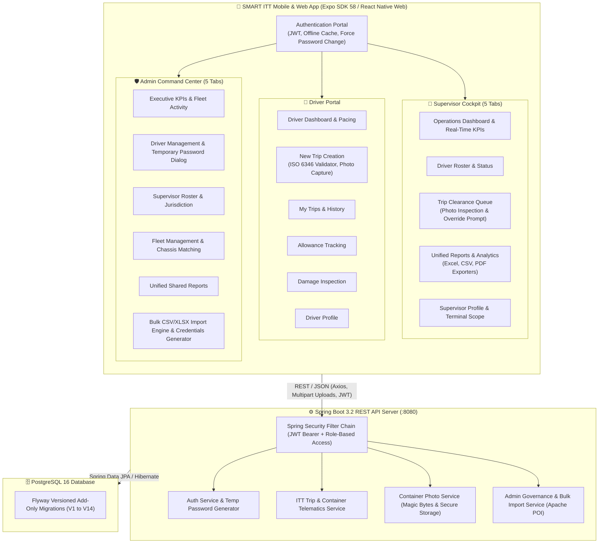

# 🚛 SMART ITT — Inter-Terminal Transportation Management System

<div align="center">

[](https://spring.io/projects/spring-boot)
[](https://expo.dev/)
[](https://www.typescriptlang.org/)
[](https://www.postgresql.org/)
[](https://www.docker.com/)
[](https://expo.dev/eas)
[](LICENSE)

<br />

**SMART ITT v2.0** is an enterprise digital logistics telematics and operations management platform engineered for real-time **Inter-Terminal Transportation (ITT)** across all 6 container terminals at the **Port of Colombo** (**CICT**, **CWIT**, **ECT**, **JCT**, **UCT**, **SAGT**). It unifies automated prime mover fleet telematics, dual 20ft/40ft container payload tracking, ISO 6346 container number check-digit validation, physical container photo inspection, live supervisor approvals, executive administration, bulk CSV/Excel onboarding, biometric authentication, and immutable audit logging.

</div>

---

## 🌟 Architecture & Core Capabilities



---

## 📋 Comprehensive Flyway Migration Version History

All database evolution follows strict **Add-Only** schema principles using Flyway:

| Version | Migration File | Description |
| :--- | :--- | :--- |
| **V1** | `V1__Create_Terminals_Table.sql` | Establishes the 6 Colombo Port terminals (`CICT`, `CWIT`, `ECT`, `JCT`, `UCT`, `SAGT`). |
| **V2** | `V2__Create_Full_Schema.sql` | Base relational schema: `users`, `drivers`, `supervisors`, `vehicles`, `trips`, `containers`. |
| **V3** | `V3__Seed_Demo_Accounts.sql` | Initial demo accounts for dev environment. |
| **V4** | `V4__Driver_Code_And_Profile_Fields.sql` | Sequential `driver_code` generator and profile fields. |
| **V5** | `V5__Seed_Vehicle_Fleet.sql` | Initial vehicle fleet seed. |
| **V6** | `V6__Add_Cover_Image_And_Text_Photos.sql` | Profile cover images and photo storage columns. |
| **V7** | `V7__Update_Vehicle_Fleet_24_Vehicles.sql` | Expanded 24 operational prime mover units. |
| **V8** | `V8__Make_Supervisor_Assigned_Terminal_Nullable.sql` | Port-wide jurisdiction support for supervisors across all terminals. |
| **V9** | `V9__Update_Vehicle_Fleet_Table_From_Image.sql` | Synchronized SCK Logistics and SDR LINK fleet plate numbers. |
| **V10** | `V10__Add_Admin_Role_And_Audit_Log.sql` | `ADMIN` role and immutable `audit_logs` security trail. |
| **V11** | `V11__Remove_Vehicle_LY5650.sql` | Decommissioned vehicle update. |
| **V12** | `V12__Add_Trip_Duration_Minutes.sql` | Server-calculated `duration_minutes` column with start/end server timestamps. |
| **V13** | `V13__Add_Container_Verification_And_Photos.sql` | Container ISO verification (`is_verified`) and `container_photos` storage table. |
| **V14** | `V14__Add_Must_Change_Password_And_Account_Metadata.sql` | `must_change_password`, `last_login_at`, and `created_by` columns in `users`. |

---

## 🔍 Container Number Validation (ISO 6346 Standard)

The system implements ISO 6346 container validation identically on frontend (`containerValidator.ts`) and backend (`Iso6346Validator.java`):

1. **Format Guard**:
   - Exactly 11 characters: `[A-Z]{3}` (Owner Code) + `[UJZ]` (Equipment Category) + `[0-9]{6}` (Serial Number) + `[0-9]` (Check Digit).
   - **Typo Guard**: Detects common driver keyboard slips where `O` or `I` are entered instead of `0` or `1` in the 6-digit serial portion, prompting with `"use 0 instead of O"`.
2. **Modulo 11 Check Digit Algorithm**:
   - Letter values: `A=10, B=12, C=13, D=14, E=15, F=16, G=17, H=18, I=19, J=20, K=21, L=23, M=24, N=25, O=26, P=27, Q=28, R=29, S=30, T=31, U=32, V=34, W=35, X=36, Y=37, Z=38` (multiples of 11 are omitted).
   - Numeric digits retain their nominal values (`0` to `9`).
   - Weighted Sum: $\sum_{i=0}^{9} \text{Value}(\text{char}_i) \times 2^i$
   - Check Digit = $\text{Sum} \pmod{11}$. If the remainder is $10$, check digit is $0$.
   - Test vectors: `CSQU3054383` (Valid), `CSQU3054384` (Invalid).
3. **One-Tap Fix & Unverified Override**:
   - When a driver enters an invalid check digit (e.g. `CSQU3054384`), the validator computes the correct check digit and shows an amber suggestion: *"Did you mean CSQU3054383?"* with a one-tap auto-correct button.
   - Drivers may confirm an unverified container anyway with a tap; it is saved with `is_verified=false` and requires physical photo capture.

---

## 📷 Physical Container Photo Verification Workflow

To guarantee container integrity before gate exit:

1. **Mandatory Photo for Unverified Loads**:
   - If a container check digit is unverified, `new.tsx` requires taking a clear photo of the container number stencil before trip submission.
2. **Optimized Capture & Upload**:
   - Client captures photo using camera or gallery (`photoCapture.ts`), auto-resizes to max dimension 1280px JPEG at 70% quality via `expo-image-manipulator`.
   - Backend endpoint `POST /api/v1/container-photos/upload` verifies JPEG magic bytes (`0xFF 0xD8 0xFF`), generates a secure UUID filename, and persists into configured upload directory (`app.upload.dir`).
3. **Supervisor Gate Inspection**:
   - In Supervisor Trips tab, any trip with unverified containers displays a prominent warning badge.
   - Supervisors open the **Photo Inspection Modal** to inspect high-resolution container photos with pinch-to-zoom.
   - Actions: **Verify Photo** (marks `VERIFIED`), **Reject Photo** (marks `REJECTED` with reason).
   - If a supervisor attempts to approve a trip with pending unverified container photos, an explicit confirmation prompt warns them before clearance.
4. **Reports & Audit Trail**:
   - Filter bar includes photo verification filter: `ALL`, `VERIFIED`, `PENDING`, `REJECTED`, `MISSING`.
   - CSV, Excel (.xlsx), and PDF reports include Container Photo Status columns.

---

## 🔐 Accounts & Enterprise Password Security

SMART ITT enforces zero hardcoded default passwords:

- **Cryptographically Secure Generator**: Backend `PasswordGenerator.java` produces 10-character random passwords containing uppercase, lowercase, numeric digits, and special characters.
- **Temporary Password Modal**: When an administrator creates a driver or supervisor or resets a password, the response returns the temporary password once. The admin UI displays it in a dedicated modal with a **"Copy Password"** button and warning: *"The user must change this password on first login."*
- **Mandatory First-Login Password Change**: If `must_change_password=true`, the app blocks normal role screens and displays `ForceChangePasswordModal`. The user must submit their current temporary password and choose a new password meeting policy rules (>=8 chars, upper, lower, number, special symbol) with a live strength meter.
- **Unique Username Validation**: All role creation endpoints check case-insensitive username uniqueness across all users (`existsByUsernameIgnoreCase`).
- **Real Audit Timestamps**: Admin tables show real metadata: Username, Created By, Created Date (formatted timestamp or `-`), Last Login (formatted timestamp or `-`).

---

## 📊 Admin CSV & Excel Bulk Import Engine

Administrators can bulk onboard Drivers, Supervisors, and Vehicles:

- **Supported Formats**: CSV and Excel (`.xlsx` via Apache POI `WorkbookFactory`).
- **Sample Templates**: One-tap template download for each entity type (`/api/v1/admin/import/templates/{type}`) with column headers, descriptions, and sample data.
- **Validation**: Required fields, NIC format, Sri Lankan mobile number format, license expiration date, and duplicate detection against both existing database records and intra-file rows.
- **Atomic Per-Row Execution**: Valid rows are imported; invalid rows are skipped and collected in an error report.
- **Summary & Error Export**: Displays total processed, imported count (green chip), failed count (red chip), with an **"Export Error CSV"** button (`Row # | Field | Value | Error Reason`).
- **Bulk Credentials Distribution**: For imported drivers and supervisors, secure random temporary passwords are automatically generated, and the admin can download the complete **"Credentials CSV"** (`Username | Temporary Password | Role | Employee ID | Full Name`) for physical or SMS distribution.

---

## 🧭 Screen Routes & Navigation Structure

### Driver Portal (`/(driver)`)
- `/(driver)/(tabs)/index` — Driver Home (300 Containers Monthly Target, pace stats, quick actions)
- `/(driver)/trips/new` — Create Trip (Terminal selection, vehicle lookup, ISO 6346 validation, recent quick-picks, photo upload)
- `/(driver)/(tabs)/trips` — My Trips (Live in-transit telemetry, history receipts)
- `/(driver)/(tabs)/allowance` — Driver allowances and earnings calculations
- `/(driver)/(tabs)/damage-report` — Vehicle and container damage incident reports
- `/(driver)/(tabs)/profile` — Profile details, vehicle license status, Port Pass expiry countdown

### Supervisor Portal (`/(supervisor)/(tabs)`)
- `/(supervisor)/(tabs)/index` — Operations Cockpit (6-Terminal throughput breakdown, pending clearance KPI)
- `/(supervisor)/(tabs)/drivers` — Fleet Drivers Directory (Status, assigned vehicles, contact info)
- `/(supervisor)/(tabs)/trips` — Gate Clearance Queue (Pending Approvals, Container Cards, Photo Inspection Modal, Approve/Reject)
- `/(supervisor)/(tabs)/reports` — Unified Reports & Analytics (Custom Date Picker, Group By Driver/Vehicle/Date, backend filters, Excel/CSV/PDF exports)
- `/(supervisor)/(tabs)/profile` — Supervisor Profile (Assigned jurisdiction, change password modal, biometric toggle)

### Admin Portal (`/(admin)/(tabs)`)
- `/(admin)/(tabs)/index` — Executive Command Dashboard (Fleet KPIs, multi-terminal volume, quick links)
- `/(admin)/(tabs)/drivers` — Driver Management (Search, filter, New Driver, Bulk Import, Reset Password, Audit details)
- `/(admin)/(tabs)/supervisors` — Supervisor Governance (All 6 Terminals roster, New Supervisor, Bulk Import, Reset Password)
- `/(admin)/(tabs)/vehicles` — Fleet Management (SCK Logistics & SDR LINK units, New Unit, Bulk Import, status toggle)
- `/(admin)/(tabs)/reports` — Unified Shared Reports (Identical high-performance reporting engine as Supervisor)

---

## ⚙️ Environment Variables

### Backend (`application.yml` / System Environment)
```properties
# Server
PORT=8080

# Database
SPRING_DATASOURCE_URL=jdbc:postgresql://localhost:5432/smart_itt_db
SPRING_DATASOURCE_USERNAME=postgres
SPRING_DATASOURCE_PASSWORD=postgres
SPRING_PROFILES_ACTIVE=dev

# JWT Security
JWT_SECRET=your-32-character-minimum-secure-jwt-secret-key-goes-here!
JWT_EXPIRATION_MS=86400000
JWT_REFRESH_EXPIRATION_MS=604800000

# File Uploads
APP_UPLOAD_DIR=./uploads/container-photos
```

### Frontend (`.env`)
```properties
EXPO_PUBLIC_API_URL=http://localhost:8080/api/v1
EXPO_PUBLIC_DEMO_DATA=false
```

---

## 👥 Test User Accounts (Usernames Only)

> **Security Note**: In compliance with enterprise credential policies, plaintext passwords are not committed. Accounts flagged with temporary credentials will automatically prompt the user to change their password on first login.

| Role | Username / Operator Code | Employee ID | Jurisdiction / Scope |
| :--- | :--- | :--- | :--- |
| **Admin** | `admin` | `EMP-ADM01` | Full System Governance |
| **Supervisor** | `SUP001` | `SUP001` | All Colombo Port Terminals |
| **Supervisor** | `SUP002` | `SUP002` | All Colombo Port Terminals |
| **Supervisor** | `SUP003` | `SUP003` | All Colombo Port Terminals |
| **Driver** | `DRV-00001` | `EMP-00101` | Fleet Prime Mover `WP-LY-5544` |
| **Driver** | `DRV-00002` | `EMP-00102` | Fleet Prime Mover `WP-LY-5545` |

---

## 🚀 Development & Build Instructions

### Prerequisites
- Java JDK 21+
- Node.js 18+ & npm
- PostgreSQL 16 (or in-memory H2 fallback for dev)
- Expo CLI (`npm install -g expo-cli eas-cli`)

### Backend Setup
```bash
cd backend
# Compile and run test suite
mvn clean test
# Run Spring Boot server
mvn spring-boot:run
```

### Frontend Setup
```bash
cd frontend
# Install dependencies
npm install
# Typecheck (Must return 0 errors)
npx tsc --noEmit
# Start Expo development server
npx expo start
```

---

## 📄 License & Attribution

This project is licensed under the **MIT License** — see the [LICENSE](LICENSE) file for details.

<div align="center">
  <sub>Engineered for Smart Maritime Logistics • Colombo Port Terminals • Built with ❤️ for Port Efficiency Innovation.</sub>
</div>
