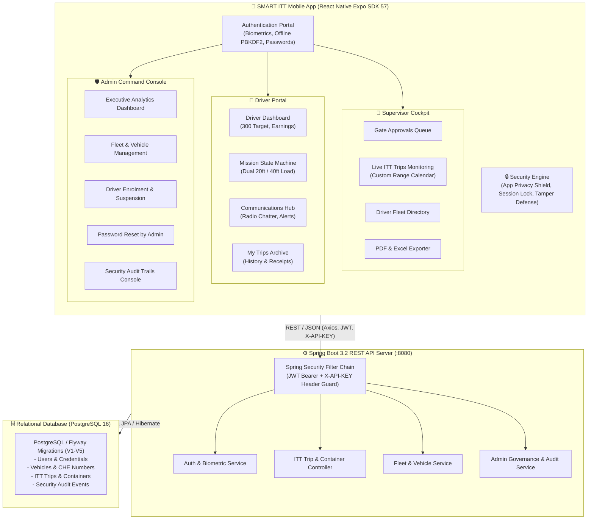

# 🚛 SMART ITT — Inter-Terminal Transportation Management System

<div align="center">

[](https://spring.io/projects/spring-boot)
[](https://expo.dev/)
[](https://www.typescriptlang.org/)
[](https://www.postgresql.org/)
[](https://www.docker.com/)
[](https://expo.dev/eas)
[](https://spring.io/)
[](LICENSE)

<br />

**SMART ITT** is an enterprise-grade digital logistics and telematics platform engineered for real-time **Inter-Terminal Transportation (ITT)** across all 6 modern maritime container terminals at the **Port of Colombo** (**CICT**, **CWIT**, **ECT**, **JCT**, **UCT**, **SAGT**). It unifies automated prime mover telematics, dual 20ft/40ft container payload tracking, live driver telecommunications, supervisor gate control, executive administrative governance, biometric authentication, and immutable audit logging.

</div>

---

## 🌟 Executive Summary & System Highlights

| Feature | Technical Realization |
| :--- | :--- |
| **Instant Vehicle ➔ CHE (SCK No) Lookup** | Real-time vehicle matcher connects any prime mover license plate (e.g. `LY 5234`) to its Port Container Handling Equipment number (`SCK 100`) and operator (`SCK Logistics`, `SDR LINK`). |
| **Driver 300 Containers Monthly Target** | Live circular progress tracker monitoring driver monthly pacing against a **300 Containers** target quota with remaining count and daily pacing. |
| **Complete End-to-End Mission Lifecycle** | Driver trip creation ➔ Supervisor gate verification ➔ In-Transit telemetry ➔ Destination in-gate discharge ➔ Permanent **My Trips** archival storage. |
| **Supervisor Monitoring & Calendar Selection** | Live trip monitoring with multi-period filters (`TODAY`, `THIS WEEK`, `THIS MONTH`) and an interactive **Custom Range Calendar Picker Modal**. |
| **Multi-Terminal Analytics (6 Terminals)** | Dedicated throughput breakdown across **CICT**, **CWIT**, **ECT**, **JCT**, **UCT**, and **SAGT** with directional inbound/outbound flow ratios. |
| **Executive Admin Console & Fleet Governance** | Complete administrative suite for vehicle tracking, driver onboarding, driver suspension with instant block, and **Admin Driver Password Reset** (default: `driver`). |
| **Comprehensive Security Audit Trails** | Searchable chronological security audit log recording **every login** (Drivers, Supervisors, Admin), logouts, lockouts, biometric checks, and unauthorized attempts. |
| **High-Grade Mobile Security Engine** | Native Biometrics (Face ID/Fingerprint), App Privacy Shield in multitasking, Brute-Force lockout countdown, and Inactivity Session Lock with Obsidian overlay. |
| **Dual-Action Session Lock Actions** | Session locked overlay with dedicated **`⇄ Switch Account`** (takes operator to `/(auth)/login`) and **`⎋ Sign Out`** (returns to Admin console). |
| **Multi-Format Dispatch Export** | One-tap export of terminal manifests in printable formatted **PDF** and Microsoft **Excel (.XLS / .CSV)** spreadsheets. |

---

## 🏗️ System Architecture & Data Flow



---

## ⚡ Role-Based Capabilities & Features

### 🚛 1. Driver Portal (`app/(driver)`)

- **300 Containers Monthly Target**:
  - Authoritative monthly driver target calibrated to **300 Containers**.
  - Visual circular progress ring, completed container counter, remaining quota, and estimated daily run pace.
  - Per-trip incentive calculator calculating **LKR 2,500** per completed ITT mission.
- **Automatic CHE (SCK No) Telematics Lookup**:
  - Instantly links any entered prime mover plate (e.g. `LY 5234`) with its Port Container Handling Equipment number (`SCK 100`) and operator (`SCK Logistics` vs `SDR LINK`).
  - Interactive horizontal fleet chip bar for 1-tap vehicle selection during trip registration.
- **Dual 20FT & 40FT Payload Validator**:
  - ISO 6346 Modulus-11 check-digit verification prevents erroneous container entries.
  - Supports loading either **1× 40FT** standard/high-cube container or **up to 2× 20FT** twin containers on heavy port skeletal trailers.
  - Dedicated fields for seal numbers, tare weights, and hazardous cargo placards.
- **Mission Lifecycle State Machine**:
  - `SUBMITTED`: Trip queued for supervisor gate pass clearance with pulsing indicator.
  - `CONFIRMED`: Terminal gate pass granted; highlights prominent emerald `START THE TRIP NOW` action.
  - `IN_TRANSIT`: Telemetry active; prime mover en route through port transit corridor; provides `ARRIVED AT TERMINAL` action.
  - `ARRIVED`: Truck checked in at destination gate; driver triggers `COMPLETE TRIP & DISCHARGE`.
  - `COMPLETED`: Containers successfully discharged; trip recorded into permanent **My Trips** log.
- **Radio Telematics & Emergency Message Center**:
  - Dispatch announcements, weather warnings, and port traffic advisories.
  - Channel filters: `ALL`, `DISPATCH`, `SAFETY`, `OPERATIONS`, `MAINTENANCE`.
  - Simulated marine acoustic radio chatter for authentic port communications.
- **Driver Profile & Credential Health**:
  - Profile photo, employee code (`DRV-00001`+), national identity card (NIC), and emergency contacts.
  - SLPA Port Pass and Heavy Vehicle License expiration tracking with proactive renewal badges.
- **Instant Account Suspension Guard**:
  - If an administrator suspends a driver, both online and offline login attempts are blocked immediately.
  - Displays a modal detailing the administration's suspension reason and instructions to contact dispatch.
  - Active sessions display a persistent crimson warning banner.

---

### 👔 2. Supervisor Operations Cockpit (`app/(supervisor)`)

- **Terminal Gate Clearance Queue**:
  - Real-time stream of queued driver submissions awaiting terminal dispatch approval.
  - Inspect vehicle plate, assigned CHE (SCK No), driver identity, container numbers, and seal integrity before dispatching.
  - 1-click **Approve & Grant Gate Pass** or **Reject / Hold for Inspection**.
- **Live ITT Trip Monitoring with Custom Date Range**:
  - Interactive period filters: **`TODAY`**, **`THIS WEEK`**, **`THIS MONTH`**, and **`CUSTOM RANGE`**.
  - **Custom Range Calendar Picker Modal**: Interactive calendar allowing supervisors to pick start and end dates to audit historical throughput across arbitrary periods.
  - Filter by terminal pairs (e.g. `JCT ➔ CICT`, `SAGT ➔ CWIT`), vehicle plate, or status (`IN_PROGRESS`, `PENDING_APPROVAL`, `COMPLETED`, `REJECTED`).
- **6-Terminal Throughput Console**:
  - Consolidated analytics across all 6 container terminals:
    - **CICT** (Colombo International Container Terminals)
    - **CWIT** (Colombo West International Terminal)
    - **ECT** (East Container Terminal)
    - **JCT** (Jaye Container Terminal)
    - **UCT** (Unity Container Terminal)
    - **SAGT** (South Asia Gateway Terminals)
  - Directional traffic breakdowns: **Total Flow**, **Origin Gate Outbound**, and **Discharge Bay Inbound**.
- **Fleet Driver Directory**:
  - Interactive roster of terminal drivers with high-resolution avatar photos.
  - Instant contact dialing (`tel:`) and WhatsApp direct dispatch links.
  - Shows shift status, assigned vehicle, and monthly progress toward the **300 Containers target**.
- **Multi-Format Report Export**:
  - **Export as Excel (.XLS / .CSV)**: Downloads formatted spreadsheet data with container details, timestamps, and driver IDs.
  - **Export as Printable PDF**: Formatted executive PDF document ready for printing or email distribution.

---

### 🛡️ 3. Admin Command & Governance Console (`app/(admin)`)

- **Executive Analytics Dashboard**:
  - Authoritative counts: Total vehicles, SCK Logistics fleet, SDR LINK fleet, Active vs Maintenance units, Enrolled drivers, Active drivers, Today's trips, Active missions, and Total container volume (20FT vs 40FT).
  - Terminal-wise trip distribution bars across all 6 terminals.
- **Supervisors Roster across All 6 Terminals**:
  - Real-time directory of Senior Yard Controllers, Gate Operations Leads, Marshalling Dispatchers, and Harbor Inspectors stationed across CICT, CWIT, ECT, JCT, UCT, and SAGT.
  - Complete with contact emails, telephone numbers, and shift hours (Day Shift 06:00 - 18:00 / Night Shift 18:00 - 06:00).
- **Driver Fleet Governance & Suspension**:
  - Enrol new prime mover operators with employee ID, NIC, driving license, and vehicle assignments.
  - **Suspend / Deactivate Driver**: Suspend non-compliant drivers with reason documentation; immediately revokes system access across all devices.
  - **Admin Driver Password Reset**: Dedicated one-click reset action restoring a driver's password to the standard initial default (`"driver"`).
- **Vehicle Fleet Management**:
  - Register new prime movers with chassis numbers, operator assignment (`SCK Logistics` or `SDR LINK`), and max container capacity.
  - Heavy vehicle road-license and harbor-pass expiration monitoring.
  - Status toggle: `ACTIVE`, `MAINTENANCE`, `INACTIVE`.
- **System Audit Trail Explorer (`audit.tsx`)**:
  - Immutable, chronological audit log recording **every login** (Drivers, Supervisors, Admins), logouts, session auto-locks, biometrics, route attempts, and administrative actions.
  - Interactive search bar by operator name, employee code, or keyword.
  - Severity level filtering: **`ALL`**, **`INFO`**, **`WARNING`**, **`CRITICAL`**.
  - One-tap **Export Logs (JSON / CSV)** for compliance audits.
- **Administrative Access & Session Controls**:
  - **Secret Easter-Egg Unlock**: 7 quick taps within 3.5 seconds or a 2.5-second long press on the Operator Login brand logo opens the Admin Portal, or direct deep-link `/(admin)/login`.
  - **Instant Header Lock Action**: Amber lock button in the header bar locks the session instantly on demand.
  - **Admin Sign-Out Modal**: Custom dual-action modal offering **Switch to Operator Login** or **Sign Out to Admin Login**.

#### 🔐 3.1 Advanced Admin Login & Multi-Factor Security Portal (`app/(admin)/login.tsx`)
The Admin Login portal is an enterprise-hardened entry point engineered with multi-layer defense, biometrics, and dynamic security controls:

- **Dual Access Gateways**:
  - **Secret Easter-Egg Trigger**: In the standard Operator Login screen, tapping the brand logo **7 times within 3.5 seconds** or performing a **2.5-second Long-Press** activates dynamic tap hints (`"Admin unlock: 4 more taps"`, `"Admin Portal Unlocked!"`) and unlocks the hidden administrative console.
  - **Direct URL Deep-Link**: Accessible directly via `/(admin)/login` with a dedicated `"Back to Operator Login"` chevron return link.
- **Hardware-Level Biometric Authentication**:
  - Native hardware detection for Apple Face ID, Touch ID, and Android Biometrics with automatic status checking.
  - 1-tap quick authentication bypassing manual password entry, logging `BIOMETRIC_AUTH_SUCCESS` to security audit trails.
- **Strict Role-Based Authorization Guard**:
  - Authenticates via Spring Boot `/auth/login` REST API with Bearer token issuance.
  - Enforces strict role verification (`user.role === 'ADMIN'`).
  - Rejects valid non-admin credentials (such as driver or supervisor logins) with explicit security alerts: *"Access Denied: Account lacks administrative privileges"*.
- **Brute-Force Lockout Defense & Dynamic Countdown**:
  - Detects and records consecutive failed password attempts via `credentialStore`.
  - Enforces automatic lockout with a real-time countdown badge displaying remaining seconds before retry is allowed.
  - Logs `LOCKOUT_TRIGGERED` security alerts with timestamp and IP/client metadata.
- **Offline Bootstrap & Development Fallback**:
  - High-resilience offline fallback allowing authorized administrators (`ADMIN`, `admin@smartitt.lk`) to bootstrap the console using verified credentials (`Admin@123`, `AdminSecure@2026`, `admin`).
  - Built-in Dev Credentials Quick Drawer for streamlined staging and QA operations.
- **Obsidian Maritime Cyber UI**:
  - Themed in Obsidian Navy (`#070d17`) with subtle watermarked background overlay (`AppBackgroundOverlay`), radial cyan and cobalt ambient glow filters, high-security verified badge icons, and animated activity indicators.

---

### 🔒 4. Enterprise Mobile Security Architecture

- **Native Biometric Authentication (`biometricService.ts`)**:
  - Hardware-level detection for Apple Face ID, Touch ID, and Android Biometric Fingerprint.
  - Auto-prompts on app resume; graceful fallback to alphanumeric password or PIN.
- **Inactivity Session Lock & Activity Watcher (`useSessionActivity.ts`)**:
  - Automatically locks inactive sessions after a configured duration (default: 5 minutes) or when the app is placed in the background.
  - Triggers the Obsidian-styled `SecurityLockOverlay`.
- **Dual-Action Session Lock Overlay (`SecurityLockOverlay.tsx`)**:
  - Displays session details, user role badge, and biometric quick-unlock button.
  - Features two distinct, beautifully styled bottom action buttons:
    - **`⇄ Switch Account`** (Cyan): Safely ends the session and navigates directly to the Operator Login (`/(auth)/login`) so a Driver or Supervisor can sign in.
    - **`⎋ Sign Out`** (Coral): Ends the administrative session and returns to the Admin Login (`/(admin)/login`).
  - Powered by a cross-platform in-app confirmation modal that works seamlessly across **iOS, Android (Expo Go), and Web**.
- **App Privacy Shield (`AppPrivacyShield.tsx`)**:
  - Obscures app contents whenever the application transitions to the background or the mobile OS app switcher, preventing shoulder surfing and sensitive data leakage.
- **Brute-Force Lockout Defense (`credentialStore.ts`)**:
  - Implements an exponential countdown lockout (60s+) after repeated failed password attempts.
  - Stores credentials with PBKDF2 salt hashing for offline authentication.
  - Enforces password history prevention (disallows previously used passwords).
- **Route Security Guard (`RouteSecurityController`)**:
  - Route-level interceptor protecting `/(admin)` from unauthorized non-admin navigation, and `/(supervisor)` from driver access.
  - Clean unauthenticated redirect routing without generating false critical security alerts during legitimate logouts.

---

## 📸 System Screenshots & Visual Showcase

### 1. Vehicle Telematics & Automatic CHE No (SCK No) Recognition
When a driver enters a vehicle license plate, the system automatically detects and displays the **Port CHE No (SCK No)** and **Fleet Operator** in real-time.

<div align="center">
  <table>
    <tr>
      <th width="50%">SCK Logistics (SCK 100)</th>
      <th width="50%">SDR LINK (SCK 115)</th>
    </tr>
    <tr>
      <td></td>
      <td></td>
    </tr>
    <tr>
      <td align="center"><b>Vehicle:</b> <code>LY 5234</code><br/><b>CHE:</b> <code>SCK 100</code></td>
      <td align="center"><b>Vehicle:</b> <code>LY 6528</code><br/><b>CHE:</b> <code>SCK 115</code></td>
    </tr>
  </table>
</div>

---

### 2. Driver Communications & Telematics Message Center
Dedicated driver communication hub featuring channel filters (`ALL`, `DISPATCH`, `SAFETY`, `OPERATIONS`, `MAINTENANCE`), priority visual badges, and simulated terminal dispatch audio transmissions.

<div align="center">
  <table>
    <tr>
      <th width="50%">Driver Communications Center</th>
      <th width="50%">Filtered Dispatch Transmissions</th>
    </tr>
    <tr>
      <td></td>
      <td></td>
    </tr>
  </table>
</div>

---

### 3. End-to-End ITT Trip Execution Lifecycle
A complete operational trial demonstrating driver submission, supervisor approval, live in-transit tracking, terminal gate-in completion, and local storage in **My Trips**.

<div align="center">
  <table>
    <tr>
      <th width="20%">Step 1: Driver Submit</th>
      <th width="20%">Step 2: Supervisor Confirm</th>
      <th width="20%">Step 3: Trip In-Transit</th>
      <th width="20%">Step 4: Trip Completed</th>
      <th width="20%">Step 5: My Trips Archive</th>
    </tr>
    <tr>
      <td></td>
      <td></td>
      <td></td>
      <td></td>
      <td></td>
    </tr>
    <tr>
      <td align="center"><small>Driver logs vehicle & 20ft/40ft container</small></td>
      <td align="center"><small>Supervisor validates & grants terminal dispatch</small></td>
      <td align="center"><small>Prime mover departs terminal origin gate</small></td>
      <td align="center"><small>Gate-in scan and arrival timestamp logged</small></td>
      <td align="center"><small>Trip permanently archived in driver log</small></td>
    </tr>
  </table>
</div>

---

### 3.1 Driver Mission Operations Console (Home Section)
The Driver Home dashboard dynamically guides the operator through each operational milestone without clutter:

<div align="center">
  
  <p><i>Driver Home Section: 300 Containers target tracker, live mission details, container breakdown, route telemetry, and dynamic action buttons.</i></p>
</div>

---

### 4. Supervisor Command Center & Driver Directory
Supervisors have access to live date-wise reporting tables and an interactive driver roster with high-resolution profile imagery and telematics telemetry.

<div align="center">
  <table>
    <tr>
      <th width="33%">Supervisor Operations Dashboard</th>
      <th width="33%">Date-Wise Dispatch Reports</th>
      <th width="33%">Driver Profile Directory</th>
    </tr>
    <tr>
      <td></td>
      <td></td>
      <td></td>
    </tr>
  </table>
</div>

---

### 4.1 Terminal-Wise Total Trips Panel (Weekly & Monthly Filters)
A consolidated terminal throughput panel providing multi-dimensional traffic analytics across all 6 container terminals (`CICT`, `CWIT`, `ECT`, `JCT`, `UCT`, `SAGT`):

<div align="center">
  
  <p><i>Supervisor Panel: 6-Terminal throughput breakdown with rolling weekly, monthly, and custom range calendar selection.</i></p>
</div>

---

### 5. Multi-Format Dispatch Export (Excel & PDF)
Supervisors can instantly export terminal dispatch records, driver performance, and container logs in both Microsoft Excel (`.XLS` / `.CSV`) spreadsheet format and printable PDF documents.

<div align="center">
  
  <p><i>Dual Action Export: <b>EXPORT AS EXCEL (.XLS)</b> in emerald and <b>EXPORT AS PDF</b> in cyan with automated print formatting.</i></p>
</div>

---

## 🗄️ Port Terminals & Fleet Mapping

### Port of Colombo Container Terminals

| Code | Terminal Full Name | Port Location | Primary ITT Routes |
| :---: | :--- | :--- | :--- |
| **CICT** | Colombo International Container Terminals | South Basin Deep Water | `CICT ⇄ JCT`, `CICT ⇄ SAGT` |
| **CWIT** | Colombo West International Terminal | West Container Terminal Basin | `CWIT ⇄ ECT`, `CWIT ⇄ CICT` |
| **ECT** | East Container Terminal | Deep Water East Basin | `ECT ⇄ JCT`, `ECT ⇄ CWIT` |
| **JCT** | Jaye Container Terminal | Main Harbor North Basin | `JCT ⇄ CICT`, `JCT ⇄ SAGT` |
| **UCT** | Unity Container Terminal | North Pier Channel | `UCT ⇄ JCT`, `UCT ⇄ ECT` |
| **SAGT** | South Asia Gateway Terminals | Queen Elizabeth Quay | `SAGT ⇄ CICT`, `SAGT ⇄ JCT` |

### Authoritative Prime Mover Fleet Database

| Vehicle No | Port CHE No (SCK No) | Fleet Operator | Max Capacity | Chassis Specification |
| :--- | :---: | :--- | :---: | :--- |
| `LY 5234` | **SCK 100** | SCK Logistics | 2 × 20FT / 1 × 40FT | Heavy Port Skeletal Multi-Hitch |
| `LY 5235` | **SCK 101** | SCK Logistics | 2 × 20FT / 1 × 40FT | Heavy Port Skeletal Multi-Hitch |
| `LY 5597` | **SCK 108** | SCK Logistics | 2 × 20FT / 1 × 40FT | Heavy Port Skeletal Multi-Hitch |
| `LY 6528` | **SCK 115** | SDR LINK | 2 × 20FT / 1 × 40FT | Heavy Port Skeletal Multi-Hitch |
| `LY 6529` | **SCK 117** | SDR LINK | 2 × 20FT / 1 × 40FT | Heavy Port Skeletal Multi-Hitch |
| `LY 6530` | **SCK 123** | SDR LINK | 2 × 20FT / 1 × 40FT | Heavy Port Skeletal Multi-Hitch |

---

## 👥 Demo Accounts & Credentials Matrix

| Role | Username / Identifier | Password | Default Target / Notes | Accessible Workspaces |
| :--- | :--- | :--- | :--- | :--- |
| **System Administrator** | `ADMIN` or `admin@smartitt.lk` | `Admin@123` / `admin` | Full System Governance | Admin Executive Console, Fleet, Supervisors Roster, Audit Trails |
| **Port Supervisor** | `SUP001` or `supervisor` | `supervisor` / `password` | Senior Yard Controller | Gate Approvals, Live Trip Monitoring, Fleet Roster, PDF/Excel Exports |
| **Port Supervisor (CWIT)** | `SUP002` | `supervisor` / `password` | Gate Operations Lead | CWIT Terminal Gate Console & Approvals |
| **Prime Mover Driver 1** | `DRV-00001` | `driver` | **300 Containers Target** | Prime Mover `LY 5234` (`SCK 100`), Mission Lifecycle, Radio Hub |
| **Prime Mover Driver 2** | `DRV-00002` | `driver` | **300 Containers Target** | Prime Mover `LY 6528` (`SCK 115`), Mission Lifecycle, Radio Hub |
| **Prime Mover Driver (Alt)** | `driver1` | `driver` / `password` | Legacy Test Driver | General ITT Driver Console |

> [!NOTE]
> All newly enrolled or reset driver accounts default to the password **`driver`**. Administrators can reset any driver's password with a single tap from the Admin Drivers console.

---

## 🚀 Installation & Execution Guide

### 1. Prerequisites
- **Node.js**: v18 or v20+ ([Download](https://nodejs.org/))
- **Java JDK**: 21+ ([Adoptium Temurin](https://adoptium.net/))
- **Expo Go App**: Installed on physical Android or iOS device ([Google Play](https://play.google.com/store/apps/details?id=host.exp.exponent) / [App Store](https://apps.apple.com/app/expo-go/id982107779))
- **Docker & Docker Compose** *(Optional for PostgreSQL backend)*

---

### 2. Running the Mobile Application (Expo Go)

```bash
# Navigate to the frontend directory
cd frontend

# Install dependencies
npm install

# Start the Expo Go development server with cache clear
npx expo start --go -c
```

1. A terminal QR code will appear.
2. Open the **Expo Go** application on your mobile device.
3. Tap **Scan QR code** and point your camera at the terminal screen.
4. The mobile app will bundle and run live with hot module reloading.

---

### 3. Building an Installable Standalone Android APK

The project is pre-configured with **EAS Build** (`eas.json` preview profile) to generate installable `.apk` packages without requiring a local Android Studio SDK:

```bash
# Navigate to frontend
cd frontend

# Login to your Expo account
npx eas-cli login

# Build the standalone Android APK on Expo Cloud
npx eas build -p android --profile preview
```

Upon completion, EAS provides a direct download link and QR code to download and install the standalone `.apk` on any Android device.

---

### 4. Running the Spring Boot Backend

```bash
# Navigate to the backend directory
cd backend

# Compile test-suite and build
./mvnw clean test-compile

# Launch Spring Boot server (Default port: 8080)
./mvnw spring-boot:run
```
*(On Windows PowerShell, use `.\mvnw.cmd spring-boot:run`).*

---

## 📂 Project Directory Structure

```text
smart_itt_app_v2/
├── backend/                             # Spring Boot 3.2 Java 21 REST API
│   ├── src/main/java/com/smartitt/
│   │   ├── admin/                      # Admin controllers, services & DTOs
│   │   ├── auth/                       # JWT authentication, security filters
│   │   ├── config/                     # SecurityConfig, DataInitializer
│   │   ├── driver/                     # Driver entities & repositories
│   │   ├── trip/                       # ITT Trip & container management
│   │   └── vehicle/                    # Vehicle matching & CHE management
│   ├── src/main/resources/             # application.properties, Flyway migrations
│   └── pom.xml                         # Maven dependencies
├── frontend/                            # React Native Expo SDK 57 Application
│   ├── app/                            # Expo Router File-Based Routing
│   │   ├── (admin)/                    # Admin console, supervisors, audit trails
│   │   │   ├── (tabs)/                 # Admin executive dashboard, drivers, vehicles, reports
│   │   │   ├── audit.tsx               # Security Audit Trail Explorer
│   │   │   ├── login.tsx               # Admin Console Login Portal
│   │   │   └── supervisors.tsx         # All 6 Terminals Supervisors Roster
│   │   ├── (auth)/                     # Operator Login (Drivers & Supervisors)
│   │   ├── (driver)/                   # Driver mission workspace & target tracker
│   │   │   ├── (tabs)/                 # Home (300 target), messages, profile
│   │   │   └── trips/                  # Container load & mission state machine
│   │   ├── (supervisor)/               # Supervisor gate operations cockpit
│   │   │   └── (tabs)/                 # Gate clearance, trip monitor, driver roster
│   │   ├── _layout.tsx                 # Root router, RouteSecurityController & shields
│   │   └── index.tsx                   # Role-based root dispatcher
│   ├── src/
│   │   ├── components/                 # SecurityLockOverlay, AdminSignOutModal, etc.
│   │   ├── hooks/                      # useSessionActivity, useResponsive, useTheme
│   │   ├── services/                   # biometricService, credentialStore, securityAuditService
│   │   ├── store/                      # Zustand authStore, adminFleetStore, mockTripStore
│   │   └── theme/                      # Obsidian & Maritime Cyber theme tokens
│   ├── app.json                        # Expo configuration manifest
│   ├── eas.json                        # Standalone Android APK build profile
│   └── package.json
└── docs/screenshots/                   # Visual proof, showcase & lifecycle screenshots
```

---

## 📄 License & Attribution

This project is licensed under the **MIT License** — see the [LICENSE](LICENSE) file for details.

<div align="center">
  <sub>Engineered for Smart Maritime Logistics • Colombo Port Terminals • Built with ❤️ for Port Efficiency Innovation.</sub>
</div>
