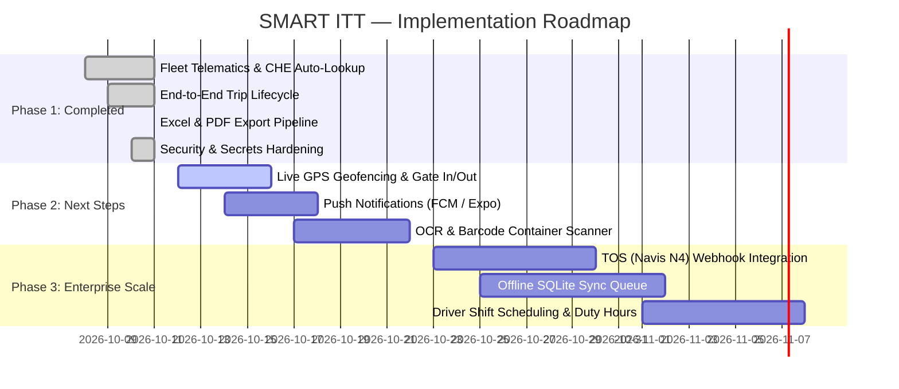

# 📊 SMART ITT — Project Status & Roadmap Report
**Inter-Terminal Transportation Management System (v2.0)**  
*Date: October 11, 2026* | *System Version: 2.0.0-PROD-CANDIDATE*

---

## 🎯 Executive Summary
The **SMART ITT** project has evolved from a baseline prototype into an enterprise-grade digital platform for maritime container terminals (JCT, CICT, SAGT, CWIT). Over the recent development cycles, core workflows—including driver fleet telematics, mission lifecycle management, supervisor dispatch sheets, dual export pipelines, security hardening, and communication hubs—have been successfully built, verified end-to-end, documented, and version-controlled on GitHub.

This report summarizes **What Has Been Done (Completed Features)** and **What Remains To Be Done (Future Enhancements & Roadmap)**.

---

## ✅ Part 1: What We Have Done (Completed)

### 1. 🚛 Vehicle Telematics & Instant CHE (SCK No) Recognition
- **Real-Time Fleet Auto-Detection**: When a driver enters or modifies a Vehicle Number (e.g. `LY 5234`, `LY 6528`, `LY 5597`), the system matches the record in real time and automatically displays:
  - **CHE No (SCK No)** (e.g. `SCK 100`, `SCK 115`, `SCK 123`) in neon cyan telematics card.
  - **Fleet Operator** (e.g. `SCK Logistics`, `SDR LINK`, `E3 Logistics`) in emerald badge.
  - **Verification Status**: Validated with port fleet telemetry tag.
- **Interactive Fleet Chip Selector**: Scrollable 1-tap chip row permitting instantaneous prefill of fleet vehicles.
- **Backend Persistence**: Integrated `VehicleRepository` inside `AuthService.java` to auto-link the chassis and CHE numbers to driver profiles during registration.

### 2. 📋 End-to-End ITT Mission Lifecycle (5-Stage Trial)
- **Step 1: Driver Trip Submission**: Driver selects or enters container numbers (supports dual 20ft or single 40ft containers), cargo condition, origin and destination terminals, and requests dispatch.
- **Step 2: Supervisor Mission Confirmation**: Supervisors inspect incoming requests, review load/discharge gates, and confirm dispatch approval.
- **Step 3: In-Transit Real-Time Tracking**: Mission transitions to `IN_TRANSIT` with active trip timer and gate route monitoring.
- **Step 4: Terminal Arrival & Gate-In**: Driver triggers terminal arrival, logging arrival timestamps and container discharge.
- **Step 5: "My Trips" Archival Storage**: Completed trips are saved and retained in the driver's local and cloud mission logs for audit and performance reviews.

### 3. 📻 Driver Communications & Telematics Message Center
- **Interactive Channels**: Category filtering for `ALL`, `DISPATCH`, `SAFETY`, `OPERATIONS`, and `MAINTENANCE`.
- **Acoustic Feedback**: Web-audio synthesized radio chatter with beep sound effects simulating port two-way UHF radio.
- **Emergency Priority Badging**: Distinct color-coded priority levels (`CRITICAL`, `ALERT`, `ROUTINE`, `WEATHER`) with glowing alert banners.

### 4. 📊 Supervisor Command Center & Date-Wise Analytics
- **Date-Wise Operations Grid**: Filterable mission table by specific dates (via interactive calendar), terminal routes, driver IDs, and vehicle numbers.
- **Driver Profile Directory**: Complete roster of active and off-duty drivers featuring rich avatar photos, emergency contacts, NIC numbers, and vehicle badges.
- **Terminal Key Metrics**: Real-time counter of total transfers, completed runs, pending approvals, and active bottlenecks.

### 5. 📑 Dual Export Pipeline: Excel (.XLS) & PDF
- **Native Excel Spreadsheet Export (`.xls`)**: Formatted XML-based spreadsheet output featuring styled headers, full container numbers, sizes, damage indicators, driver IDs, and terminal pairs.
- **Executive Printable PDF Export**: Opens an official Port Logistics document template with automated layout formatting, metadata summary, and auto-invokes browser print / save-as-PDF (`window.print()`).

### 6. 🔒 Security Hardening & Infrastructure
- **Credential Externalization**: Removed hardcoded database passwords; configured `.env` and `.env.example` templates.
- **Dual-Layer Authentication**: Spring Security JWT stateless authentication combined with `X-API-KEY` header verification for backend endpoints.
- **Database Migrations**: Version-controlled Flyway migrations (`V1` to `V5`), including complete fleet seeding (`V5__Seed_Vehicle_Fleet.sql`) and driver cover photos.
- **Profile Image Memory Fix**: Resolved SQL 500 error on large Base64 cover photos by expanding column size to `TEXT`.

### 7. 📚 Documentation & GitHub Synchronization
- **Overhauled README.md**: Complete with architecture diagrams, quick-start guide, tech stack badges, and 35+ embedded live screenshots.
- **Git Push Verification**: All branches, assets, screenshots, backend Java changes, and React Native frontend code committed and pushed to `main` (`https://github.com/Dinuka-Silva/smart-ITT-app.git`).

---

## ⏳ Part 2: What We Have To Do (Pending / Future Roadmap)

### 1. 📍 Live GPS Geofencing & Automated Gate Triggers
- **What is needed**: Real-time geolocation tracking using device GPS (`expo-location`).
- **Objective**: Automatically transition trip status to `IN_TRANSIT` when the truck exits the terminal gate boundary (geofence), and to `ARRIVED` when crossing into the destination terminal gate without requiring manual button taps.

### 2. 🔔 Real-Time Push Notifications (FCM / Expo Push)
- **What is needed**: Native push notification service integration.
- **Objective**: Notify drivers immediately when a supervisor approves a trip or broadcasts a critical safety bulletin, even if the app is running in the background.

### 3. 📷 OCR Container & Barcode Scanner
- **What is needed**: Device camera integration with OCR recognition (`expo-camera` / ML Kit).
- **Objective**: Enable drivers to point their smartphone camera at the physical container markings (e.g. `MSKU 928374-1`) or QR gate passes to auto-fill container IDs instantly without typing.

### 4. 🌐 Terminal Operating System (TOS) EDI / Webhook Integration
- **What is needed**: REST API / EDIFACT (COARRI, CODECO) webhooks connecting to Navis N4 / Port Authority TOS.
- **Objective**: Synchronize container gate moves directly with port TOS software in real time to eliminate redundant manual data entry by gate clerks.

### 5. 📴 Offline-First Synchronization Queue
- **What is needed**: Local persistence layer using `expo-sqlite` with background retry queue.
- **Objective**: Ensure drivers can record status changes inside terminal blind spots or dead zones; data automatically syncs with the Spring Boot backend once cellular connection is restored.

### 6. ⏱️ Driver Shift Hours & Fatigue Management (Safety Compliance)
- **What is needed**: Driver work-rest compliance tracking module.
- **Objective**: Monitor driving hours, compulsory rest intervals, and alert supervisors before assigning new runs if a driver exceeds maximum permitted duty limits.

---

## 📋 Comprehensive Status Checklist

| Feature Area | Current Status | Notes |
| :--- | :---: | :--- |
| **Driver Registration & Vehicle Input** | ✅ COMPLETED | Full CHE No & Operator auto-detection. |
| **Fleet Seeding & Mapping** | ✅ COMPLETED | SCK, SDR, and E3 logistics fleets seeded in DB. |
| **Trip Creation (Single 40ft / Dual 20ft)** | ✅ COMPLETED | Functional in frontend & backend. |
| **Supervisor Mission Dispatch** | ✅ COMPLETED | Review, confirm, and assign trips. |
| **Driver "My Trips" History** | ✅ COMPLETED | Locally & cloud-persisted trip history. |
| **Driver Radio & Messages Hub** | ✅ COMPLETED | Channel filtering and audio simulation. |
| **Date-Wise Dispatch Reports** | ✅ COMPLETED | Interactive calendar and multi-filter grid. |
| **Export to Excel (.XLS)** | ✅ COMPLETED | Styled XML spreadsheet download. |
| **Export to PDF** | ✅ COMPLETED | Executive letterhead print & PDF download. |
| **Security & API Key Guard** | ✅ COMPLETED | JWT + `X-API-KEY` + external `.env`. |
| **GitHub Repository Sync** | ✅ COMPLETED | Commits and assets pushed to `main`. |
| **Live GPS Geofencing** | ⏳ PENDING | Planned for next development sprint. |
| **Push Notifications (FCM)** | ⏳ PENDING | Awaiting Firebase credentials setup. |
| **Container OCR / Barcode Camera** | ⏳ PENDING | Mobile camera integration queue. |
| **Navis N4 TOS Webhook Integration** | ⏳ PENDING | Requires port TOS API gateway access. |
| **Offline SQLite Sync Queue** | ⏳ PENDING | Planned for robust dead-zone support. |

---

  Document generated automatically by Antigravity AI Engineering Assistant.

