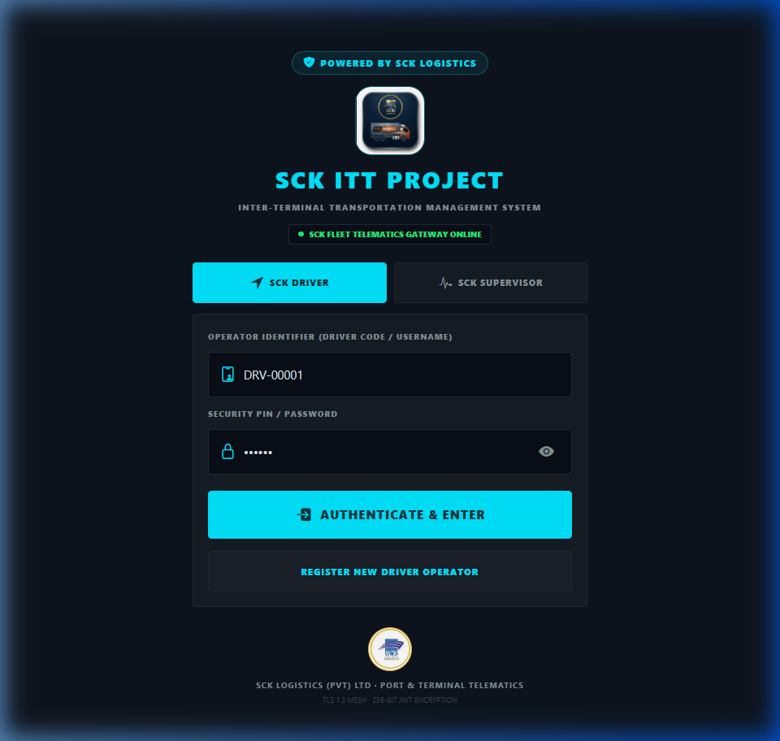
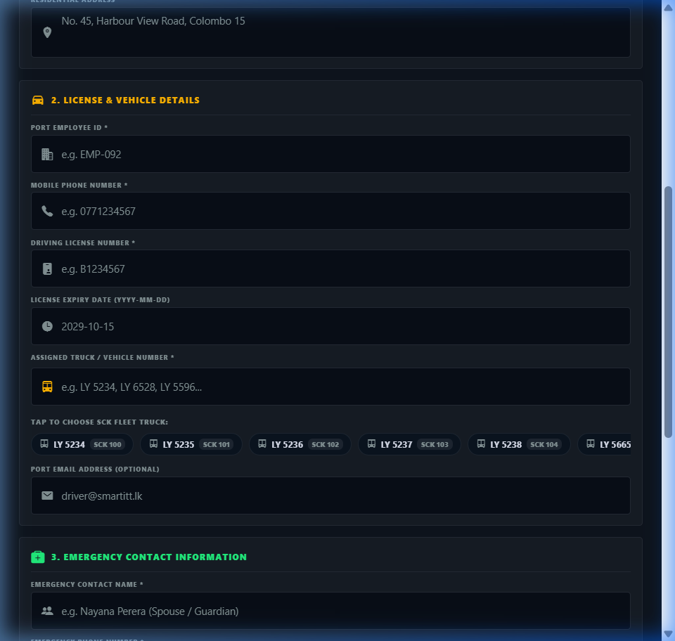

# 🚛 SMART ITT — Port Logistics Mobile Application

Official cross-platform mobile application powering Inter-Terminal Transportation (ITT) operations across all 6 container terminals at the **Port of Colombo** (**CICT**, **CWIT**, **ECT**, **JCT**, **UCT**, **SAGT**).

Engineered with **React Native**, **Expo SDK 57**, **Expo Router**, **TypeScript**, and **Tailwind / Nativewind**.

---

## 🚀 Key Functional Modules

### 🚛 1. Driver Operations & Target Tracking (`app/(driver)`)
- **300 Containers Monthly Quota**: Live circular progress tracking with remaining containers and daily target pacing.
- **Instant Prime Mover ➔ CHE (SCK No) Lookup**: Automatic detection linking license plates (`LY 5234`, `LY 6528`) to Port Container Handling Equipment numbers (`SCK 100`, `SCK 115`).
- **ISO 6346 Modulus-11 Validator**: Check-digit validation supporting dual 20ft or single 40ft container loading.
- **Mission Lifecycle State Machine**: `SUBMITTED` ➔ `CONFIRMED` ➔ `IN_TRANSIT` ➔ `ARRIVED` ➔ `COMPLETED & DISCHARGED`.
- **Permanent "My Trips" History**: Full local and cloud storage of completed runs and discharge timestamps.
- **Acoustic Radio Dispatch Hub**: Marine audio transmission simulation with category priority filters.
- **Account Suspension Guard**: Instant login lockout with administration reason display if an account is suspended.

### 👔 2. Supervisor Operations Cockpit (`app/(supervisor)`)
- **Gate Clearance & Approval Queue**: 1-click verification of origin gate-out passes and container integrity.
- **Live Trip Monitoring with Custom Date Range**: Multi-period filter (`TODAY`, `THIS WEEK`, `THIS MONTH`) and an interactive **Calendar Range Picker Modal**.
- **6-Terminal Throughput Console**: Real-time traffic analytics across CICT, CWIT, ECT, JCT, UCT, SAGT.
- **Fleet Driver Directory**: Certified drivers directory with avatars, contact dials, and 300-target progress.
- **Multi-Format Manifest Export**: Instant generation of formatted Microsoft Excel (`.XLS` / `.CSV`) and printable PDF reports.

### 🛡️ 3. Admin Command & Governance Console (`app/(admin)`)
- **Executive Analytics Dashboard**: Real-time fleet distribution, active/maintenance prime movers, enrolled drivers, and container traffic.
- **Supervisors Roster across 6 Terminals**: Roster of senior controllers and harbor inspectors stationed across all Colombo terminals.
- **Driver Enrolment & Suspension**: Add drivers, assign prime movers, or suspend non-compliant personnel with instant access revocation.
- **Admin Driver Password Reset**: Dedicated one-click reset restoring any driver's password to `"driver"`.
- **Vehicle Fleet Management**: Prime mover registration, chassis specs, and license expiration tracking.
- **Security Audit Trail Explorer (`audit.tsx`)**: Chronological audit trail recording **every login**, logouts, session locks, and biometric checks.
- **On-Demand Lock Session & Dual Sign-Out**: Amber lock action in header; custom modal with **Switch Account** and **Sign Out**.
- **Advanced Admin Login Portal (`app/(admin)/login.tsx`)**:
  - **Secret Easter-Egg Access**: Unlocked via 7 rapid taps in 3.5s or 2.5s long-press on the Operator Login logo with live countdown toast, or direct URL `/(admin)/login`.
  - **Native Biometric Login**: 1-tap Face ID / Touch ID / Fingerprint verification directly into the admin console with audit log tracking.
  - **Role-Based Authorization Barrier**: Rejects non-admin users with *"Access Denied"* security alerts even on valid credentials.
  - **Brute-Force Lockout Defense**: Dynamic countdown timer badge after repeated failed attempts with security event emission.
  - **Offline Bootstrap & Dev Drawer**: Offline credential support (`ADMIN` with `Admin@123`, `AdminSecure@2026`, `admin`) and quick demo credentials drawer.

### 🔒 4. Enterprise Mobile Security Engine
- **Biometric Authentication**: Native hardware Face ID, Touch ID, and Android Biometrics with fallback.
- **Inactivity Session Lock (`SecurityLockOverlay`)**: Inactivity watcher auto-locking sessions with dedicated **`⇄ Switch Account`** (Operator login) and **`⎋ Sign Out`** (Admin console) buttons.
- **App Privacy Shield**: Conceals screen data in mobile OS multitasking view.
- **Tamper & Lockout Defense**: 60s+ countdown lockouts and PBKDF2 salt hashing for offline authentication.

---

## 🛠️ Technology Stack

| Layer | Technology |
|---|---|
| **Framework** | React Native / React 19 / Expo SDK 57 |
| **Routing** | Expo Router (File-based navigation) |
| **Language** | TypeScript 5.3+ |
| **State Management** | Zustand & TanStack Query |
| **Security & Storage** | Expo LocalAuthentication, SecureStore, SQLite |
| **Icons & Design** | `@expo/vector-icons` (Ionicons), Obsidian Cyber Theme |
| **Standalone Build** | EAS Build (`eas.json` preview profile for Android `.apk`) |

---

## ⚡ Quick Start & Run Commands

### 1. Run in Expo Go
```bash
# Install dependencies
npm install

# Start Expo Go development server
npx expo start --go -c
```
Scan the terminal QR code using the **Expo Go** app on your physical mobile phone.

### 2. Build Standalone Android APK
```bash
# Login to Expo
npx eas-cli login

# Build standalone APK in cloud
npx eas build -p android --profile preview
```

### 3. Type Checking
```bash
npx tsc --noEmit
```

---

## 📸 Application Visual Showcase

### 1. Operator Portal & Fleet Registration
<div align="center">
  <table>
    <tr>
      <th width="50%">Authentication Portal</th>
      <th width="50%">Fleet Registration Chips</th>
    </tr>
    <tr>
      <td></td>
      <td></td>
    </tr>
  </table>
</div>

### 2. Vehicle Matching & Automated CHE Lookup
<div align="center">
  <table>
    <tr>
      <th width="50%">SCK Logistics (SCK 100)</th>
      <th width="50%">SDR LINK (SCK 115)</th>
    </tr>
    <tr>
      <td></td>
      <td></td>
    </tr>
  </table>
</div>

### 3. ITT Mission Lifecycle & Communications Hub
<div align="center">
  <table>
    <tr>
      <th width="33%">Step 1: Driver Submit</th>
      <th width="33%">Step 2: Gate Pass Approval</th>
      <th width="33%">Step 3: Trip In-Transit</th>
    </tr>
    <tr>
      <td></td>
      <td></td>
      <td></td>
    </tr>
    <tr>
      <th width="33%">Step 4: Terminal Discharge</th>
      <th width="33%">Step 5: My Trips Archive</th>
      <th width="33%">Radio Message Hub</th>
    </tr>
    <tr>
      <td></td>
      <td></td>
      <td></td>
    </tr>
  </table>
</div>

### 4. Supervisor Command Center & Date-Wise Dispatch
<div align="center">
  <table>
    <tr>
      <th width="50%">Supervisor Operations Cockpit</th>
      <th width="50%">Date-Wise Dispatch Reports</th>
    </tr>
    <tr>
      <td></td>
      <td></td>
    </tr>
  </table>
</div>

---

## 👥 Demo Credentials

| Role | Username | Password | Notes |
| :--- | :--- | :--- | :--- |
| **Admin** | `ADMIN` | `Admin@123` / `admin` | Full Executive Console |
| **Supervisor** | `SUP001` or `supervisor` | `supervisor` / `password` | Gate Operations |
| **Driver 1** | `DRV-00001` | `driver` | **300 Target**, Truck `LY 5234` (`SCK 100`) |
| **Driver 2** | `DRV-00002` | `driver` | **300 Target**, Truck `LY 6528` (`SCK 115`) |
